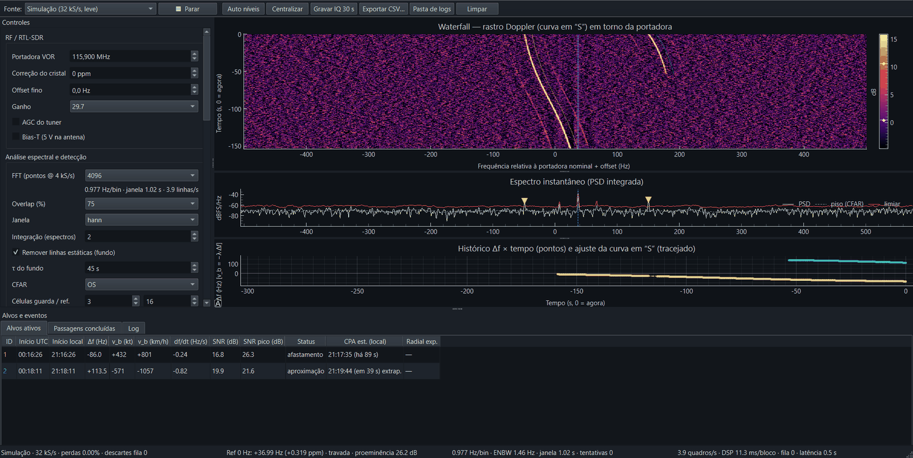
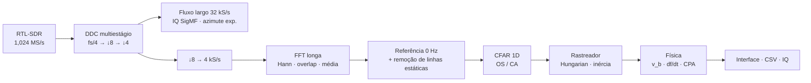
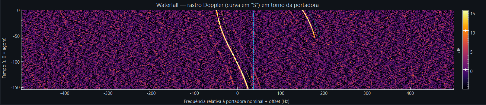

# VOR Passive Radar · PP2LA

[](https://github.com/lualcorreia/VOR-Passive-Radar-PP2LA/actions/workflows/tests.yml)


[](LICENSE)

**Radar passivo bistático por efeito Doppler** que usa a iluminação de um
radiofarol **VOR** (108–117,95 MHz) e um **RTL-SDR** para detectar reflexões
fracas na fuselagem de aeronaves. Ele acompanha o traço Doppler em "S" e estima
em tempo real a velocidade bistática, $df/dt$ e a passagem pelo ponto mais
próximo (CPA).

> **English summary** — A real-time bistatic passive radar that uses a VOR
> navigation beacon as the illuminator of opportunity and an RTL-SDR as the
> receiver. It is designed for sites with **no line of sight** to the VOR. A
> multistage DDC narrows the signal to 4 kS/s, long FFTs give ~1 Hz bins, and
> background-normalised OS-CFAR, a Hungarian tracker and an S-curve CPA fit
> run behind a PyQt6/PyQtGraph interface. A physics-based simulator and a
> replay mode let you validate everything without aircraft.



---

## Como funciona

```
          VOR (iluminador)                         aeronave
              ●  ─────────────── R_T ───────────────▶ ✈
               \                                     │
                \  sem visada direta (relevo)        │ R_R  (eco fraco, Δf)
                 \                                   ▼
                  ✕ ─ ─ ─ ─ ─ ─ ─ ─ ─ ─ ─ ─ ─ ─ ─ ─ ▶ 📡 receptor (RTL-SDR)

     Δf = −(1/λ)·d(R_T + R_R)/dt        v_b = −λ·Δf        λ ≈ 2,59 m
```



Detalhes da física, das escolhas de DSP e dos limites de cada estimativa estão
em **[docs/fisica.md](docs/fisica.md)**.

## Recursos

- **Waterfall em tempo real** com zoom em torno da portadora, barra de cores
  ajustável e modo *normalizado* (fundo estático removido) ou *bruto*.
- **PSD instantânea** com piso de ruído (CFAR), limiar e marcadores dos picos.
- **Histórico Δf × tempo** com o ajuste da curva em "S" de cada passagem.
- **Tabela de alvos**: horário UTC/local, Δf, $v_b$ (kt e km/h), $df/dt$,
  SNR atual e de pico, status (aproximação / cruzamento / afastamento) e CPA
  estimada.
- **Referência de 0 Hz automática** pela linha de Doppler nulo, quando existe.
- **Controles de RF**: frequência, ppm, offset fino em Hz, ganho manual (AGC
  desligado por padrão) e Bias-T.
- **Logs CSV** de cada passagem e de cada ponto, e **gravação IQ SigMF**
  automática com pré-buffer ao detectar um alvo.
- **Simulação física** (VOR + ecos bistáticos + ruído + erro de LO) e
  **replay** de gravações SigMF ou `.cu8`.
- **[Experimental]** radial da aeronave em relação ao VOR, pela fase 30 Hz
  AM × FM 9960 Hz do próprio eco.



## Hardware

- RTL-SDR Blog V3 (R820T2, TCXO 1 ppm). Outros RTL-SDR também funcionam.
- Antena VHF omnidirecional para a banda aeronáutica (108–118 MHz).
- Recepção **sem visada direta** ao VOR é o caso pretendido: o sinal direto
  forte mascararia os ecos.

## Instalação

### Windows

1. Instale o driver **WinUSB** na *interface 0* do dongle com o
   [Zadig](https://zadig.akeo.ie/).
2. Instale o Python 3.10 ou superior e, na pasta do projeto, rode:

   ```bat
   py -3 -m venv .venv
   .venv\Scripts\pip install -r requirements.txt
   ```

   O pacote `pyrtlsdrlib` já inclui a `rtlsdr.dll`.

### Linux

```bash
sudo apt install librtlsdr0          # ou o equivalente da sua distribuição
python3 -m venv .venv && . .venv/bin/activate
pip install -r requirements.txt
```

Também dá para instalar como pacote, com o comando `vorradar`: `pip install -e .`

## Uso

```bat
iniciar_radar.bat                 :: Windows (ou: python -m vorradar)
iniciar_radar.bat --sdr           :: já começa capturando do RTL-SDR
iniciar_radar.bat --sim           :: já começa em simulação
```

| Opção | Efeito |
|---|---|
| `--sdr` / `--sim` / `--sim-full` | inicia na fonte escolhida (simulação leve a 32 kS/s, ou na cadeia completa a 1,024 MS/s) |
| `--logdir PASTA` | grava logs e IQ desta execução em outra pasta |
| `--screenshot ARQ.png --after S` | salva uma captura da janela após S segundos e fecha |

**Primeiros passos:** escolha a fonte, ajuste a **Portadora VOR** para o VOR
da sua região (o padrão é 115,900 MHz, VOR BRS de Brasília) e clique em
**Iniciar**. Na simulação, a primeira aeronave aparece em menos de meio minuto e
outras a cada 1–2 minutos.

| Controle | Padrão | Observação |
|---|---|---|
| Ganho | 29,7 dB | suba até o limite antes de saturar (veja `tools/gain_sweep.py`) |
| FFT | 4096 pontos | 0,98 Hz/bin, janela de 1,02 s |
| Integração | 2 espectros | ganho de detectabilidade de ~1,5 dB |
| Limiar CFAR | 9 dB | menor: mais sensível, mais alarmes falsos |
| Remover linhas estáticas | ligado | some a portadora residual e o clutter |
| Referência 0 Hz automática | ligada | a barra de status avisa quando não há linha estática |

### Saídas

| Arquivo | Conteúdo |
|---|---|
| `logs/eventos_AAAAMMDD.csv` | uma linha por passagem: Δf máx/mín, $v_b$, $df/dt$, SNR de pico, CPA, instante de Δf = 0, parâmetros do ajuste, intervalos de velocidade e distância, radial (exp.) |
| `logs/pontos_AAAAMMDD.csv` | série temporal de cada trilha: Δf, $v_b$, SNR, potência |
| `logs/iq/*.sigmf-data` + `.sigmf-meta` | IQ de 32 kS/s (cf32) de cada detecção, reproduzível no modo Replay |
| `config.json` | último estado da interface |

## Validação

Os testes em [`tests/test_pipeline.py`](tests/test_pipeline.py) rodam o
pipeline completo contra a verdade do simulador físico (também no
GitHub Actions):

```bash
python -m pytest -s            # ou: python -m tests.test_pipeline
```

| Verificação | Resultado |
|---|---|
| Frequência de um tom após o DDC e a FFT | 123,392 Hz para 123,400 Hz reais |
| Δf medido × Doppler bistático real (passagem de 150 s) | **0,09 Hz RMS** (≈ 0,4 kt em $v_b$) |
| Referência automática × erro de LO simulado | 36,99 Hz para 37 Hz |
| Instante de Δf = 0 (mínimo de $R_T+R_R$) | erro de 0,01 s |
| Velocidade real dentro do intervalo estimado | 200 m/s ∈ [155, 310] m/s |
| Azimute experimental (eco forte, sem sinal direto) | erro ≤ 0,5° |
| Replay de gravação SigMF | alvo reencontrado |
| Cadeia completa a 1,024 MS/s em tempo real | ~15 % de um núcleo no PC de teste |

Com o hardware real, o teste de captura (`tools/iq_capture_test.py`) mediu
**0 amostras perdidas** em 10 s a 1,024 MS/s.

## Limitações (leia antes de interpretar os números)

- **Δf e $v_b$ absolutos dependem da referência de 0 Hz.** Sem linha de
  Doppler nulo (sem visada nem difração), eles carregam o erro do oscilador
  (até ±116 Hz/ppm em 116 MHz). Calibre o ppm do dongle ou use o offset fino.
  $df/dt$, a forma do "S" e a CPA não são afetados.
- **$v_b$ não é a velocidade da aeronave** ($|v_b| \le 2v$).
- **Não há distância absoluta**: o sinal é CW e não há referência direta para
  medir atraso. A CPA, a velocidade e a distância vêm do ajuste da curva e são
  dadas como **intervalos** entre duas hipóteses geométricas. O instante $t_0$
  pode ter viés de alguns segundos em geometria bistática.
- **Azimute experimental**: exige eco forte e degrada se o sinal direto
  estiver presente.

## Estrutura do repositório

```
vorradar/            pacote principal
  sources.py         RTL-SDR (captura assíncrona, medição de perdas), simulação, replay
  dsp.py             DDC, FFT, fundo, referência 0 Hz, CFAR, picos
  tracker.py         associação, confirmação, inércia, fantasmas AM 30 Hz
  physics.py         v_b, df/dt, ajuste da curva em "S" (CPA), geometria
  vor_azimuth.py     [experimental] radial pela fase 30 Hz AM × FM 9960 Hz
  simulator.py       gerador de IQ físico (VOR + ecos bistáticos + ruído)
  recorder.py        CSV de eventos/pontos e gravação SigMF
  engine.py          thread de processamento que liga tudo
  gui.py             interface PyQt6 + PyQtGraph
tests/               validação contra o simulador (pytest)
tools/               diagnósticos de hardware
docs/                física, processamento de sinais e imagens
```

### Ferramentas de diagnóstico

| Script | Uso |
|---|---|
| `tools/iq_capture_test.py [MHz] [s]` | abre o dongle, mede a taxa efetiva e as perdas de amostras |
| `tools/gain_sweep.py [MHz]` | saturação do ADC e potência para cada ganho |
| `tools/vor_scan.py [MHz] [s] [dB]` | procura vestígios do VOR (portadora, ±30 Hz, 9960 Hz, ident) em ±16 kHz |

## Licença

[MIT](LICENSE) © 2026 Lucas Alexandre Gama Correia, **PP2LA**.
